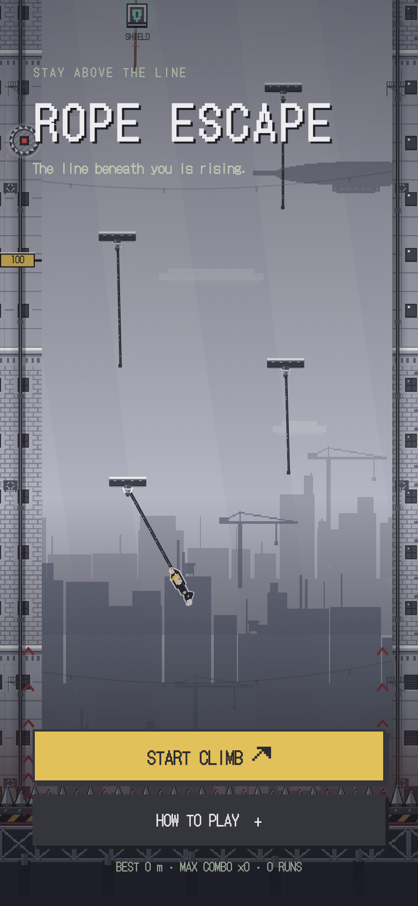
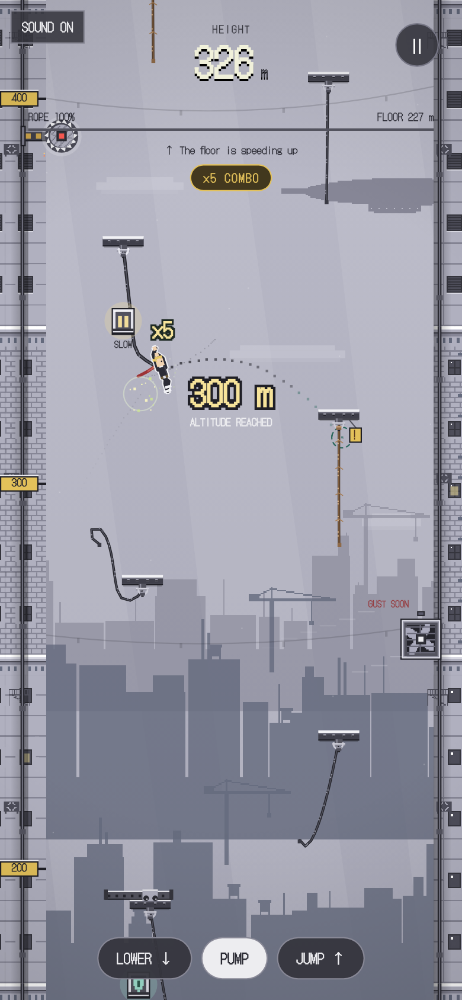
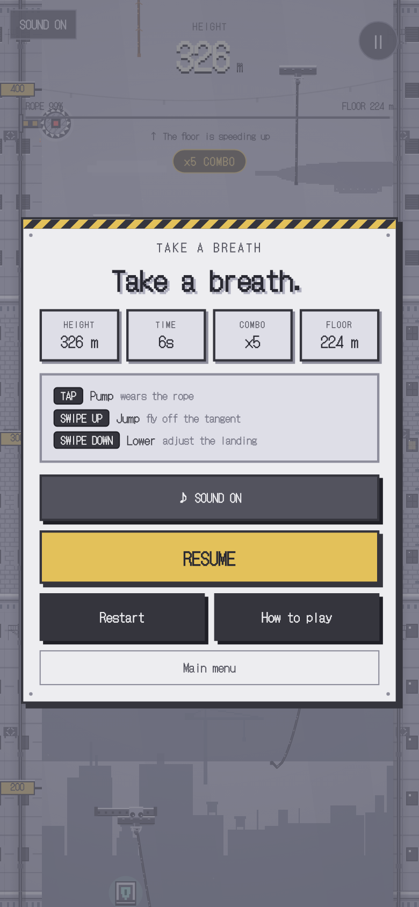
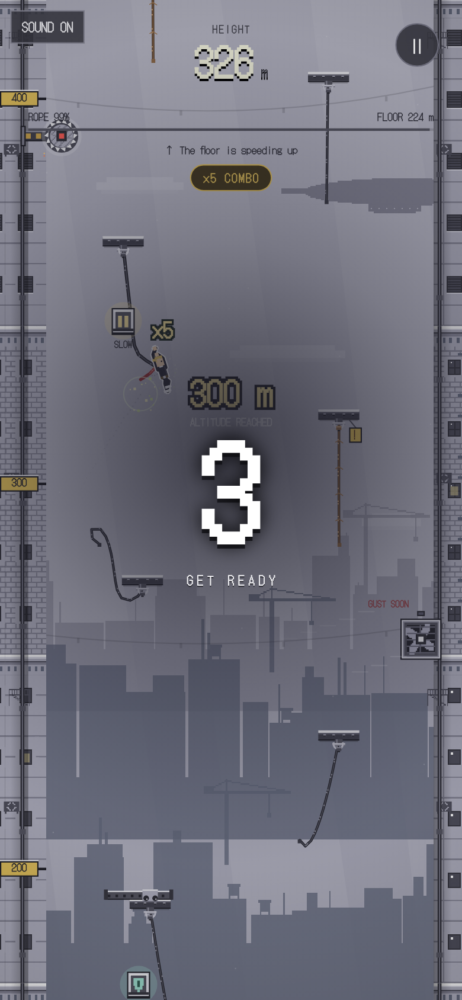
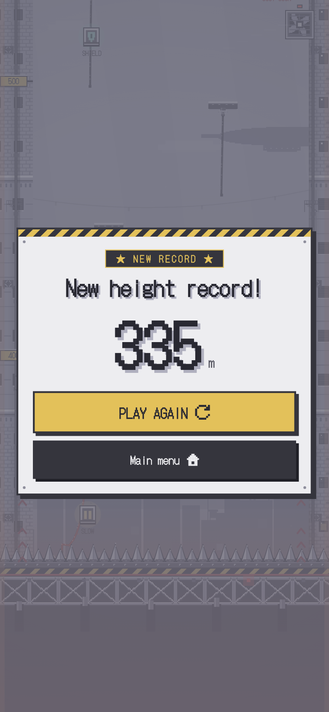

# 繩索逃生 Rope Escape · Flutter 雙平台版

以 Flutter 重寫的 iOS／Android 版本，玩法與畫面延續原本的 React + Canvas 網頁版（已移除）：柔軟 Verlet 繩索、擺盪動量、同一積分器產生的預測線、隨機錨點／陷阱／道具、持續上升的死亡平台、工業像素風的暫停與結算面板。

本目錄是完整獨立的 Flutter 專案，素材與字型已複製進 `assets/`，不依賴網頁版目錄。

## 遊玩畫面

截圖由 `flutter test` 以真實素材與字型渲染（`test/screens_test.dart`），存於 `docs/screens/`。

| 主選單 | 遊玩中 | 暫停 |
| :-: | :-: | :-: |
|  |  |  |

| 恢復倒數 | 結算 |
| :-: | :-: |
|  |  |

## App Store 素材

`tool/store_capture.sh` 會在 iOS 模擬器上自動遊玩一場（`integration_test/store_capture_test.dart`，以遊戲自己的預測器決定何時加力、放長、跳離），依階段擷取截圖並把錄影剪成 App Preview：

```sh
xcrun simctl list devices available            # 取得模擬器 UDID
tool/store_capture.sh <iPhone 17 Pro Max UDID> output/store/iphone-6.9 886x1920
tool/store_capture.sh <iPad Pro 13-inch UDID>  output/store/ipad-13    1200x1600
```

輸出到指定目錄：選單／提示／遊玩／暫停／倒數／結算的 PNG（iPhone 6.9 吋 1320×2868、iPad 13 吋 2064×2752）、`preview-<WxH>.mp4`（H.264、30 fps、30 秒內、含靜音音軌）與原始 `raw.mov`。每場隨機，若想要更長的遊玩可再跑一次。

## 需求

- Flutter 3.41 以上（Dart 3.11）
- iOS：Xcode 15 以上、CocoaPods；Bundle ID `com.ivan9527945.ropeEscape`（Team 自動簽署）
- Android：Android SDK 36、接受 SDK 授權（`flutter doctor --android-licenses`）；Application ID `com.katsumitec.rope_escape`

### 套件

| 套件 | 用途 |
| --- | --- |
| `audioplayers` | 低延遲播放離線合成的音效與配樂（iOS 使用 ambient 類別，與其他 App 混音） |
| `path_provider` | 將合成好的 WAV 寫入暫存目錄 |
| `shared_preferences` | 個人紀錄（最佳高度、場次、最佳連擊、最長時間、累計） |

## 啟動與驗證

```sh
flutter pub get
flutter analyze
flutter test                      # 物理回歸（11 項）+ 畫面截圖測試（輸出至 output/screens/）
flutter test test/rope_core_test.dart   # 只跑物理測試
flutter test integration_test/store_capture_test.dart -d <udid>   # 模擬器自動遊玩（見上方）
flutter run                       # 連接的裝置或模擬器
flutter build ios --simulator     # 模擬器建置
flutter build ipa                 # App Store 上架需先在 Xcode 設定簽署
flutter build appbundle           # Google Play（AAB）
```

`test/screens_test.dart` 會用真實素材與字型渲染選單、遊玩、暫停、倒數與結算畫面並存成 PNG（`output/screens/`）。測試環境沒有系統字型，部分繁體中文與符號可能顯示為方框；實機會自動回退到系統字型（PingFang／Noto Sans CJK）。若要更新 README 的截圖，跑完測試後把 `output/screens/` 的圖複製到 `docs/screens/`。

## 程式結構

- `lib/main.dart`：App 進入點，鎖定直向、沉浸式全螢幕。
- `lib/game/types.dart`：繩索、角色、陷阱、道具、粒子、統計與狀態型別（`ClimbState` 含 `clone()` 供預測使用）。
- `lib/game/rope_core.dart`：擺盪、跳離、抓取、陷阱、道具、里程碑、擦過判定與上升平台；`stepClimb` 為固定 1/60 秒步進，`predictClimb` 以同一積分器在複本上預測軌跡，不會動到真實狀態。
- `lib/game/soft_rope.dart`：Verlet 節點、約束、回彈與曲線碰撞。
- `lib/game/particles.dart`：由模擬種子驅動的確定性粒子。
- `lib/game/weather.dart`：時間驅動的風場排程。
- `lib/game/controller.dart`：固定 60 Hz 步長的 `Ticker` 迴圈、預測快取、事件→音效／震動、暫停倒數、介面快照（`GameView`）。
- `lib/render/`：`Draw` 畫布工具、場景（天空、雲、光束、纜線、façade、高度牌）、人物與繩索／錨點、機關／道具／粒子／護盾、死亡平台與後製。人物為程式繪製的像素攀繩者（`climber.dart` 的 `_drawFigure`）：抓繩時身體沿繩索方向、雙手輪流上抓、屈膝勾繩，空中則伸手撲向下一條繩。舞台邏輯寬度固定 360，高度依裝置比例在 640～960 之間延伸，手機不出現黑邊；比舞台更寬的螢幕（iPad）則左右留邊，確保 HUD 與控制鈕在畫面內。
- `lib/audio/synth.dart`、`game_audio.dart`：啟動時在背景 isolate 離線合成與網頁版相同配方的音效與配樂（WAV），以 `audioplayers` 低延遲播放；合成完成前所有播放呼叫皆為空操作；介面提示音在暫停時仍可播放；緊張度以播放速率調整配樂節奏。
- `lib/ui/`：工業鋼板主題元件（`SteelPanel`、`SteelButton`、`StatTile`、警示條）、選單／HUD／控制鈕／倒數／暫停／結算／指南面板、`shared_preferences` 紀錄與評級（S／A／B／C／D 依高度 1500／900／500／200 m 分級）。

## 操作

- 點按畫面或「PUMP」：增加擺幅（消耗繩索耐久）。
- 向上／橫向滑動或「JUMP」：沿切線跳出，自動抓住新繩索。
- 向下滑動或「LOWER」：延長繩索。
- 右上「Ⅱ」暫停；從暫停恢復有 1.5 秒凍結倒數；App 退到背景會自動暫停。
- 抓繩（輕）、擋下鋸輪／斷繩／拾取道具（中）、死亡（重）皆有觸覺回饋。
- 系統開啟「減少動態效果」時會自動降低畫面晃動等動態。

## 素材授權

`assets/sprites/` 內所有像素圖均由 `tool/gen_sprites.py` 程式產生（天際線、立面磁磚、桁架、飛船、冷氣與逃生梯），人物以程式繪製，沒有第三方遊戲素材；授權同本專案（MIT）。字型 DotGothic16 與 Silkscreen 採 SIL Open Font License 1.1，見 `assets/fonts/`。

## 上架資訊

- iOS Bundle ID：`com.ivan9527945.ropeEscape`；Android：`com.katsumitec.rope_escape`。
- 支援頁 [SUPPORT.md](SUPPORT.md)、隱私政策 [PRIVACY.md](PRIVACY.md) 供 App Store Connect 使用。
